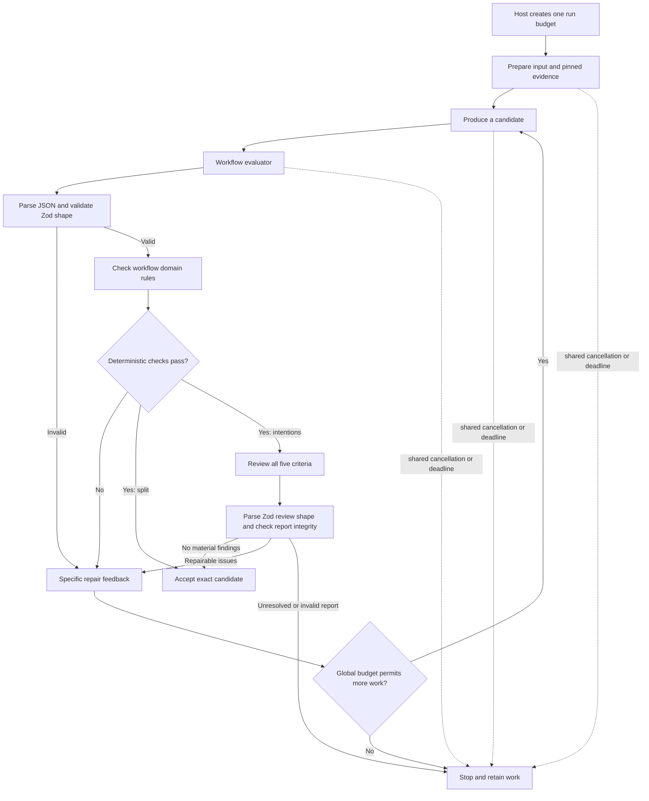

# Reusable Evaluator–Optimizer Implementation Plan

> **For agentic workers:** REQUIRED SUB-SKILL: Use superpowers:subagent-driven-development (recommended) or superpowers:executing-plans to implement this plan task-by-task. Steps use checkbox (`- [ ]`) syntax for tracking. Execute the numbered tasks sequentially; finish the current task's checks and review before starting the next.

**Goal:** Add a reusable generate–evaluate–repair loop, adopt it in semantic split, and require evidence-grounded semantic review before intentions are accepted.

**Architecture:** `@daphne/evaluator-optimizer` owns proposal iteration, a common run-budget contract, cancellation, feedback and completed-attempt retention. `@daphne/llm` owns the reusable model/tool conversation protocol through `runModelConversation`, borrowing caller-owned history and callbacks without knowing domain evidence or artifacts. Each workflow supplies its producer and evaluator; every stage uses the same run budget. Intentions wraps the shared conversation protocol with evidence delivery and writer/reviewer records. Semantic split retains its deterministic evaluator and existing generation path, including initial token-count reuse. Both workflows own Zod model-output schemas, with explicit domain validation after shape parsing; the common runner remains independent of Zod.

**Tech Stack:** TypeScript 6.0.3, Node 24.22.0, Bun 1.4.3 for package management, native ESM, Zod 4 with native JSON Schema generation (exact reviewed release selected in Task 2), existing `@daphne/llm` and evidence packages, Vitest 5.0.5.

**Spec:** The decisions below capture this conversation: budget policy is global, operation-specific call quotas are not requirements, no backward compatibility or new artifact version is needed, and Zod adoption covers both workflows' proposal schemas and the new intentions reviewer report. Repository baselines are [architecture](../../architecture.md), [migration scope](../../migration/README.md), [split coverage design](../specs/2026-10-22-split-coverage-repair-design.md), and [intentions ADR](../../adr/0005-pr-intentions-workflow.md). Earlier descriptions of fixed correction counts are historical behavior, not requirements to preserve.

## Execution status — 2026-10-31

Tasks 1–3 and the shared LLM conversation extraction are committed. Tasks 4–6 are implemented in the current working tree for review, with no new commit. Reviewer code lives in `packages/intentions/src/review/`; its [README](../../../packages/intentions/src/review/README.md) explains how it participates in `workflow.ts` evaluation.

Per the user’s instruction, test files remain unchanged: planned new reviewer, workflow and artifact-reader tests are deferred. Existing checks and temporary offline assertion exercises verify mechanics, not live provider acceptance or reviewer quality. Task 7’s paid schema/quality runs remain unexecuted and require separate approval; the selected inputs are `daphne-proj/pr-review-test` PRs #1, #2 and #3.

## Global Constraints

- This planning turn changes only this document. Do not implement production code, change tests, run paid models or commit automatically. The inspected code baseline is commit `d035340` on `feat/evaluator-optimizer`.
- Use one budget policy for the whole run, resolved at its outer entry point and shared by preparation, generation, review, repair and tools. Do not allocate separate writer, reviewer, page-analysis or tool quotas.
- There is no mandatory numeric effort limit in the common package or either workflow. Optional overall timeout and candidate ceiling are configured once for the run. Three candidates is an experiment setting, not a production constant or a claim of optimality.
- Remove the intentions generation/tool quotas and both workflows' local correction ceilings. Keep actual usage counters for diagnostics.
- Optimize for satisfying the complete acceptance criteria. Stop on acceptance, an explicit unresolved decision, an operational failure, cancellation or exhaustion of a configured global budget. More calls alone do not establish a better result.
- Every accepted candidate must have completed evaluation, including the final candidate permitted by a configured ceiling. Never publish a draft whose review was skipped or interrupted.
- The common package knows no citation criteria, provider, Git repository, evidence schema, environment variables, telemetry or persistence. It may use standard cancellation/timer facilities to construct a run budget.
- Deterministic validation remains mandatory. Unsupported material claims and inadequate citations block intentions acceptance; cosmetic preferences alone do not require repair.
- Use one strict Zod definition per model-output shape: split grouping proposal, intentions writer proposal and intentions reviewer report. Infer raw types and generate plain JSON Schema from it; remove redundant handwritten shape checks. Keep contextual/domain validation explicit and preserve trusted citation enrichment.
- Zod belongs in `@daphne/semantic-split` and `@daphne/intentions`, with the same exact dependency version. Add no shared schema package, Zod requirement in the common runner, or repository-wide migration of tool arguments, artifact decoders or the independent offline judge.
- Failed workflows have null accepted proposal/response while retaining diagnostic work. Preserve evidence bytes/IDs, pinned revisions, UTF-8 ranges, ordering, unknown semantics and reference datasets.
- Keep PR resources in `@daphne/pr-review`, run configuration and publication in the host, and offline judging/telemetry in `apps/eval`.
- Change current result/artifact contracts directly and update affected consumers together. Do not add format versions, old-format adapters, temporary compatibility aliases or legacy parsing branches. Historical outputs remain untouched research records, not supported current inputs.
- Add no RCI/PCG implementation, split semantic critic, generic criterion registry, score threshold, best-candidate ranking, checkpoint store or transport retry framework.
- Use public workspace exports, `workspace:*`, `.js` relative ESM imports, focused files and a README with the new package's first implementation. Follow repository TypeScript, readability and module-boundary policies.
- Tests below are proposed work, not performed or implicitly authorized by this planning turn. Execution authorization must include scoped test changes; otherwise run existing checks and report the gap, following `AGENTS.md`.
- Use pinned runtimes. Update the lockfile with dependencies, verify `bun install --frozen-lockfile`, format changed files and run `bun run check`. Do not weaken validation or edit golden data to pass.

## Review Focus

1. Cancellation or review failure after a completed candidate retains the draft but cannot accept it (Tasks 1, 2 and 5).
2. Reviewer-discovered source becomes writer-citable only after actual delivery to that writer conversation (Tasks 3 and 5).
3. The final model turn may be a review; accepted output must link to its exact writer candidate and accepting evaluation (Task 5).
4. A repair can introduce a new defect or hide material coverage; all criteria run again (Tasks 4 and 5).
5. A shared budget must cover preparation and tool continuations without resetting per stage or leaking between concurrent runs (Tasks 1–3, 5 and 6).

---

## Decisions, Assumptions and Missing Information

### Agreed decisions

| Concern           | Decision                                                                                                                                                    |
| ----------------- | ----------------------------------------------------------------------------------------------------------------------------------------------------------- |
| Reuse             | One runner receives workflow-owned production and evaluation operations.                                                                                    |
| Criteria          | Criteria belong to the workflow, not a central map with per-feature toggles.                                                                                |
| Global budget     | One policy and one cancellation/deadline boundary per end-to-end run. Stages use the resources they need within it; there are no operation-specific quotas. |
| Generic limits    | No production requirement for three, four or 24 calls. Any candidate ceiling is a configurable run-level control.                                           |
| Candidate         | A completed proposal reply; tool continuations, token counts and reviewer replies are not proposal candidates.                                              |
| Intentions checks | Deterministic structure/provenance first, then all five semantic dimensions: accuracy, citations, rationale, coverage and coherence.                        |
| Review order      | Inspect factual/citation support first within every review, then rationale, meaningful coverage and coherence. Criteria do not change between iterations.   |
| Split checks      | Retain JSON/schema and exact original-inventory coverage, including duplicates/unknown IDs. No new semantic reviewer.                                       |
| Repair            | Return specific defects and relevant source content; generate a complete replacement and fully re-evaluate it.                                              |
| Uncertainty       | Unknown motivation is valid; qualify unsupported claims without hiding material changes.                                                                    |
| Contracts         | Update current consumers directly. Backward compatibility and artifact version migration are out of scope.                                                  |
| Schema ownership  | Both workflows own strict Zod model-output schemas, inferred raw types and generated JSON Schema. The common runner consumes typed results without Zod.     |

Split coverage assigns every hunk/metadata unit exactly once. Intentions coverage explains material behavior; its cards may share evidence and change IDs. Generic reuse does not mean identical domain criteria.

### Implementation choices proposed by this plan

- A global run policy supports optional `timeoutMs` and `maxCandidates`. Absent fields mean no corresponding application ceiling. Values are selected once by the host; the common package supplies no mandatory numeric defaults or workflow-name lookup.
- Use existing cancellation facilities rather than building a token/dollar allocation service. Record calls, tokens and latency. Aggregate monetary/token enforcement would be a separate requirement, not silently approximated by counting all operations as equal.
- Use one existing OpenAI client per intentions run and the same configured model for both roles. Keep one continuing writer conversation and one fresh reviewer conversation per structurally valid candidate.
- Reviewer access uses existing read-only evidence tools. Malformed review output is an evaluation execution failure; there is no hidden reviewer retry loop.
- Derive acceptance from a validated structured report. Keep the runtime policy and independent offline judge separately owned, with aligned meanings for the five dimensions.
- Keep public complete/failed workflow outcomes; generic termination reasons and retained reports explain unresolved work.

### Information that may change later tuning

| Unknown                                                     | Effect                                                                                                                                                                                                                    |
| ----------------------------------------------------------- | ------------------------------------------------------------------------------------------------------------------------------------------------------------------------------------------------------------------------- |
| Reviewer reliability and marginal benefit of further repair | Task 7 measures defects fixed, regressions and resource use; do not claim an optimal iteration count.                                                                                                                     |
| Appropriate global settings for different deployments       | None are prescribed as universal constants. Hosts can configure the same policy without editing workflows.                                                                                                                |
| Model/request capacity and memory requirements              | Respect actual provider capacity and explicit infrastructure bounds. Current application byte/output defaults are not universal provider limits.                                                                          |
| Exact Zod release and generated-schema provider acceptance  | Task 2 pins a reviewed Zod 4 release; Tasks 2–4 inspect and check generated requests offline. Task 7 verifies live provider acceptance for all three schemas. Unsupported export features must not weaken runtime checks. |
| Earlier A/B/C outputs                                       | Missing from this checkout; do not make implementation depend on them.                                                                                                                                                    |
| Additional PR cases and permission for new paid runs        | Needed for broad quality qualification, not the offline implementation. Earlier approval covered earlier nine API runs only.                                                                                              |
| Referenced chart                                            | No separate chart file was supplied; the flow below restates the discussed design.                                                                                                                                        |

Without a configured finite global ceiling, an unproductive tool conversation can continue until cancellation or failure. This is an explicit configuration consequence; do not hide a replacement call-count limit inside a workflow. Acceptance still depends on evaluated quality rather than exhausting available resources.

## Verified Repository Baseline

| Area                 | Current code                                                                                                                                                                                                                          | Planned change                                                                                                                                          |
| -------------------- | ------------------------------------------------------------------------------------------------------------------------------------------------------------------------------------------------------------------------------------- | ------------------------------------------------------------------------------------------------------------------------------------------------------- |
| Intentions limits    | `packages/intentions/src/limits.ts` hard-codes `maxGenerations: 24`, `maxToolCalls: 24`, `maxCorrections: 1`.                                                                                                                         | Remove these operation/correction quotas. They came from existing application code, not PR #1 measurements or provider capacity.                        |
| Split loop           | `workflow.ts` uses exported `maxCorrections: 3` and permits four grouping replies.                                                                                                                                                    | Replace local scheduling/ceiling with the shared runner and resolved global policy.                                                                     |
| Split validator      | `getExpectedUnitIds` / `validateProposal` enforce exact coverage of original hunk/metadata units.                                                                                                                                     | Preserve the complete deterministic gate and repair evidence.                                                                                           |
| Model-output shapes  | Split repeats fields in JSON Schema, `Proposal` and manual parsing. Intentions repeats response structure across schema/parser; its public citations also contain trusted source data absent from model output. Zod is not installed. | Introduce Zod in both owning packages, derive raw types and JSON Schema, and remove duplicated shape parsing without conflating raw and trusted output. |
| Intentions validator | `validateIntentions` checks structure, known/distinct IDs within each card, delivery/provenance, revisions, UTF-8 ranges and exact PR quotations.                                                                                     | Replace shape parsing with Zod, retain domain validation/enrichment and add semantic support/meaningful coverage checks.                                |
| Delivery             | Intentions has one history and one delivered set, marking all completed tools delivered after a model reply.                                                                                                                          | Separate histories/delivery by conversation before introducing a reviewer.                                                                              |
| Host timeouts        | Intentions CLI sets a ten-minute deadline. Split CLI and eval do not use the same overall policy.                                                                                                                                     | Resolve one common optional run timeout at every outer entry point before preparation; remove the intentions-only hard-coded timeout.                   |
| Request bounds       | Input/output token, request-byte and retained-memory bounds exist at different layers.                                                                                                                                                | Keep them distinct from total effort; do not freeze existing values into a generic workflow policy or label them all provider limits.                   |
| Artifacts            | Intentions reader selects `investigation.turns.at(-1)`; split reader requires `maxCorrections === 3`.                                                                                                                                 | Update in place: explicit accepted writer/evaluation reference and recorded optional run ceiling. Remove obsolete assumptions.                          |
| Offline judge        | `apps/eval/src/intentions/judgment.ts` uses five dimensions against frozen evidence, with no manual expected-fact labels.                                                                                                             | Keep independent from runtime feedback.                                                                                                                 |
| Accounting           | `createOpenAI` has request-local histories and per-client counters.                                                                                                                                                                   | Reuse one client, annotate roles and keep counters diagnostic.                                                                                          |
| Tests                | Split and CLI split tests exist; intentions/PR-review lack dedicated tests, eval has smoke infrastructure.                                                                                                                            | Add targeted offline coverage in the owning workspaces as authorized.                                                                                   |
| Documentation        | Architecture prose about grouping differs from the actual intention-based split prompt.                                                                                                                                               | Correct prose; do not alter prompts to match stale documentation.                                                                                       |

Available historical outputs: `outputs/intentions-20261027-231228-37049/run.json` contains structural UTF-8 citation repair; `outputs/intentions-20261027-233537-54278/run.json` contains two tool turns and one proposal. Neither establishes semantic optimization or a suitable global budget.

## Flow and Ownership

The budget is shared across every stage. Provider calls and tools have no separate allowance. Each independent run receives fresh budget state; concurrent PR evaluations do not consume a shared process-wide counter.

## File and Boundary Map

Paths are relative to the repository root. New test files below are planned, not present today.

| Files                                                                                                                          | Responsibility                                                                                                |
| ------------------------------------------------------------------------------------------------------------------------------ | ------------------------------------------------------------------------------------------------------------- |
| New `packages/evaluator-optimizer/src/contracts.ts`, `budget.ts`, `runner.ts`, `index.ts`                                      | Common run policy, resolved budget, cancellation, generic loop and exports.                                   |
| New package `README.md`, `package.json`, `tsconfig.json`, `tsconfig.build.json`                                                | First real implementation, public API overview and build setup.                                               |
| New package `tests/runner.test.ts`, `budget.test.ts`, `runner.helpers.ts`                                                      | Generic callback ordering, optional limits and independent run state.                                         |
| `packages/semantic-split/src/{workflow,contracts,schema,proposal,index}.ts`, manifest/build reference, README                  | Shared runner/budget, Zod proposal shape and explicit coverage; remove local correction-limit API.            |
| Existing split `tests/workflow.test.ts`, `workflow.helpers.ts`, `proposal.test.ts`                                             | Preserve validation/replay; update assertions tied to removed local limits.                                   |
| New `packages/llm/src/conversation.ts`, public exports and conversation tests/helpers                                          | Exact counting, capacity checks, full replay, sequential tools and terminal-turn retention.                   |
| New `packages/intentions/src/conversation.ts`                                                                                  | Domain conversation settings, scoped evidence delivery and diagnostic records over the shared LLM protocol.   |
| New intentions `review/contracts.ts`, `review/schema.ts`, `review/prompts.ts`, `review/validation.ts`, `review/review.ts`      | Inferred report types, strict Zod schema, contextual parsing, semantic policy and review execution.           |
| Intentions `workflow.ts`, `prompts.ts`, `limits.ts`, `contracts.ts`, `index.ts`, package config                                | Runner integration, current trace contracts and removal of operation quotas.                                  |
| Intentions `tools.ts`, `context.ts`, `proposal.ts`, `schema.ts`                                                                | Zod writer schema, typed raw parsing and trusted citation enrichment; retain tool argument handling.          |
| New intentions `tests/proposal.test.ts`, `conversation.test.ts`, `review.test.ts`, `workflow.test.ts`, `intentions.helpers.ts` | Proposal/schema, protocol, semantic report and workflow scenarios.                                            |
| `packages/pr-review/src/{split,intentions}.ts`, package config; new `tests/intentions.test.ts`, `intentions.helpers.ts`        | Pass the same budget into acquisition/evidence/workflows and retain resource cleanup.                         |
| CLI `src/{split-pr,intentions,intentions-report}.ts`, package config; existing split and new intentions tests/helpers          | Host policy resolution, direct artifact updates and safe publication.                                         |
| Eval `src/intentions/{artifact,evidence}.ts`, new `artifact-trace.ts`; new artifact tests/helpers                              | Current accepted-candidate/source verification with no legacy branch.                                         |
| Eval `src/split-pr/{command,run,evaluate,score,experiment,trial,contracts,upload}.ts`, package config                          | Common trial policy, shared proposal validation, generated-schema hashing and removal of fixed-limit parsing. |
| Root `tsconfig.json`, `eslint.config.mjs`, `bun.lock`                                                                          | Build references, public imports and dependency boundaries.                                                   |
| Architecture/READMEs/command docs and new `docs/adr/0006-evaluator-optimizer.md`                                               | Current ownership, global policy, acceptance and direct consumer migration.                                   |

`@daphne/llm` does not need a provider abstraction or retry facility. Its current per-request transport timeout and request capacity checks are different from global effort policy. Review them as infrastructure constraints; changing every existing limit is not required for this package.

## Model-Output Schema Contract

Zod adoption covers three model responses within the existing tasks. Schemas remain local to their workflows; neither CLI/eval consumers nor the common runner need a Zod dependency merely to consume validated results or plain JSON Schema.

| Owner / task                 | Runtime schema and inferred type                                                                                                                           | Model-facing JSON Schema / validator                                                                                                                                    |
| ---------------------------- | ---------------------------------------------------------------------------------------------------------------------------------------------------------- | ----------------------------------------------------------------------------------------------------------------------------------------------------------------------- |
| Semantic split / Task 2      | `proposalOutputSchema` in `schema.ts`; infer `Proposal` and re-export its type through `proposal.ts` and the package index.                                | Keep public `proposalSchema` as generated plain JSON Schema and `validateProposal(text, expectedUnitIds): ProposalValidation`.                                          |
| Intentions writer / Task 3   | `intentionsOutputSchema` in `schema.ts`; infer internal `RawIntentionsProposal` and any nested raw types needed by citation/claim validation.              | Keep `intentionsSchema` as generated plain JSON Schema and the public `validateIntentions` entry point. Its result remains the validated/enriched `IntentionsProposal`. |
| Intentions reviewer / Task 4 | `intentionReviewOutputSchema` in `review/schema.ts`; infer `IntentionReview` and its structural subtypes in `review/contracts.ts` using type-only imports. | Generate `intentionReviewSchema`; `parseIntentionReview(value, context)` applies shape validation, then contextual integrity checks.                                    |

- Use `z.strictObject` for every response object. Reject missing/unexpected fields and invalid union variants; do not strip unknown keys, coerce types, inject defaults or trim/transform source text. Preserve required/nonempty collections, nonblank text and safe integer rules with non-mutating checks. Split reason/warning strings keep their existing allowance for empty strings.
- Keep JSON decoding separate from `safeParse` and domain checks. Split retains `invalid_json`, `invalid_shape` and `invalid_coverage` with ordered missing/duplicate/unknown IDs. Intentions retains invalid-result diagnostics; malformed reviewer output remains an evaluation failure. Format schema issue paths and useful messages into existing domain diagnostics, without serializing Zod internals or requiring legacy wording.
- Domain functions consume the parsed raw type without repeating its object/primitive checks. They still verify inventory membership/coverage, delivered evidence, revision sides, UTF-8 boundaries, exact author quotations and reviewer consistency. Preserve original bytes and ordering. Only intentions' evidence validator constructs trusted `IntentionCitation.source`; model output cannot supply it.
- Use native `z.toJSONSchema` without a separate conversion dependency. Generated schemas must be root objects with required fields, strict nested objects and provider-supported unions/constraints. Inspect the generated representation against the configured provider's documented subset; runtime refinements and contextual checks are not assumed to be represented. Keep conversion failures visible; do not use `unrepresentable: 'any'` to silently weaken a schema. If a required runtime-only check prevents export, retain it explicitly after shape parsing instead of maintaining a second manual shape.
- Count, send, record and hash the same generated plain schema. In particular, split eval's `run.ts` hashes exported `proposalSchema`; a changed schema serialization legitimately changes the experiment prompt hash. Do not serialize Zod objects or preserve an old hash by hashing different request content.
- Keep Zod values private unless an actual consumer requires them. The schema modules must not import their consumers at runtime; inferred contract imports are type-only. Preserve narrow ESLint package restrictions. Intentions' existing `strictObject` JSON Schema helper remains needed by `tools.ts`; keep it for those unchanged tool schemas.

Reference behavior: [Zod parsing/type inference](https://zod.dev/basics), [strict objects](https://zod.dev/api#objects), and [native JSON Schema generation and limitations](https://zod.dev/json-schema). These establish capabilities; they do not prove that our generated requests are accepted by the provider.

## Common Public Contract and Budget

These are interface specifications, not implementation bodies.

| Export                                                     | Contract                                                                                                                                                                                                                                                               |
| ---------------------------------------------------------- | ---------------------------------------------------------------------------------------------------------------------------------------------------------------------------------------------------------------------------------------------------------------------- |
| `RunBudgetPolicy`                                          | `{ maxCandidates?: number; timeoutMs?: number }`; present values must be positive safe integers within platform timer bounds where applicable. No feature names, role quotas or mandatory defaults.                                                                    |
| `RunBudget`                                                | Immutable resolved `{ signal: AbortSignal; maxCandidates: number \| null; deadlineAt: number \| null }`. Null means that ceiling was not configured.                                                                                                                   |
| `RunBudgetSnapshot`                                        | `Omit<RunBudget, 'signal'>`; the serializable resolved settings/timing stored as `budget` in both workflow results and artifacts.                                                                                                                                      |
| `createRunBudget`                                          | `createRunBudget(policy: RunBudgetPolicy, signal: AbortSignal): RunBudget`; copy/validate policy, start its optional deadline now and combine it with caller cancellation.                                                                                             |
| `Production<Candidate, Feedback>`                          | `{ kind: 'initial' }` or `{ kind: 'revision'; previous: Candidate; feedback: Feedback }`.                                                                                                                                                                              |
| `IterationContext`                                         | `{ number: number; budget: RunBudget }`; candidate number is one-based and the budget is the same instance supplied by the host.                                                                                                                                       |
| `Evaluation<Accepted, Feedback>`                           | `{ status: 'accept'; value: Accepted }`, `{ status: 'revise'; feedback: Feedback }`, or `{ status: 'stop'; reason: string }`.                                                                                                                                          |
| `Attempt<Candidate, Feedback, Accepted>`                   | `{ number; candidate; evaluation }`, where evaluation is `Evaluation<Accepted, Feedback> \| null`; null means it did not complete.                                                                                                                                     |
| `EvaluatorOptimizerOptions<Candidate, Feedback, Accepted>` | `budget`, `produce(request: Production<Candidate, Feedback>, context: IterationContext): Candidate \| Promise<Candidate>`, and `evaluate(candidate: Candidate, context: IterationContext): Evaluation<Accepted, Feedback> \| Promise<Evaluation<Accepted, Feedback>>`. |
| `EvaluatorOptimizerResult<Candidate, Feedback, Accepted>`  | Readonly attempts plus `status`: `accepted` with value; `exhausted` after the configured candidate ceiling; `stopped` with reason; `failed` with stage (`produce`/`evaluate`) and original error; or `cancelled` with reason and original callback cause or null.      |
| `runEvaluatorOptimizer`                                    | `runEvaluatorOptimizer<Candidate, Feedback, Accepted>(options: EvaluatorOptimizerOptions<Candidate, Feedback, Accepted>): Promise<EvaluatorOptimizerResult<Candidate, Feedback, Accepted>>`.                                                                           |

Budget resolution and enforcement:

- Hosts create the budget once before acquisition/paging, then pass it unchanged through PR adapters, workflows, model requests, tools and successful publication. Do not start a new timeout at every stage or retry.
- Add the same optional `--run-timeout-ms` and `--max-candidates` host controls to both CLI commands and the eval experiment command. With neither supplied, there is no application effort ceiling; retain user cancellation. Validate options before external work.
- Direct library callers use `createRunBudget` and supply that budget. Replace duplicated workflow `signal` options with `budget`; downstream I/O still receives `budget.signal`. `onModelCall` and per-request `maxInputTokens` retain their existing purposes.
- Do not implement a total-token/dollar ledger, dynamic quota allocator or model-capability registry. Per-request capacity and memory bounds remain explicit technical constraints; they are not writer/reviewer spending allocations.
- Record the resolved policy/deadline and actual usage in results/artifacts. Never serialize an `AbortSignal`; persist only its plain configuration/timing metadata.
- A positive candidate ceiling bounds completed proposal attempts only. It does not reserve model/tool calls for particular phases. If absent, the loop continues until an evaluator or global cancellation stops it.

Runner guarantees:

- Check cancellation before production/evaluation, after completed callbacks and before acceptance. Store a returned candidate immediately before post-production checks; store a returned evaluation before post-evaluation checks.
- A throwing producer creates no completed candidate; the consumer retains partial replies/tools. A throwing evaluator leaves that candidate with null evaluation.
- On callback throw during abort, return cancelled with the original cause; otherwise retain the original error in a failed result. Do not replace provider failures with generic wrappers.
- Evaluate the last candidate before accepting or returning candidate exhaustion. Deadline interruption can prevent evaluation from completing but never makes the draft acceptable.
- Only the previous candidate and its feedback flow through the generic revision request. The consumer owns longer history and domain-specific evidence.
- Return readonly history without cloning arbitrary generic values. Callbacks must not mutate prior candidates/feedback/evaluations.
- Keep acceptance value separate from raw candidate and feedback. Add no persistence, ranking or provider-specific hooks.

## Intentions Review and Trace Contract

### Domain review report

Define `IntentionReviewCriterion` as the five literal values `accuracy`, `citations`, `rationale`, `coverage`, `coherence`, owned by `@daphne/intentions`.

`IntentionReview` contains:

- `dimensions`: all five named keys, each with `status: 'pass' | 'issues_found' | 'insufficient_evidence'` and a nonblank `explanation`.
- `cards`: exactly one entry per current card, with zero-based `index` and `findings`.
- Each finding names `criterion`, `field` (`title`, `changeIds`, `before`, `after`, or `why`), `severity: 'material' | 'advisory'`, a nonblank `explanation`, known/distinct `evidenceIds` and `changeIds`, and a `remedy`.
- `remedy` is `{ kind: 'revise'; instruction: string }` or `{ kind: 'unresolved'; reason: string }`, with nonblank text. An advisory finding cannot require an unresolved stop.
- `omissions`: material proposal-wide omissions, each naming at least one known change, a nonblank explanation and the same remedy shape. These belong to the coverage dimension.

`parseIntentionReview(value: unknown, context: IntentionReviewContext): IntentionReview` first validates `intentionReviewOutputSchema`, then checks every card/dimension, index ranges, ID uniqueness/identity and consistency. Infer the report shape and criterion union from this schema instead of duplicating them in handwritten interfaces. `IntentionReviewContext` supplies the current `IntentionsProposal`, known changes and evidence IDs actually delivered to this reviewer. Its source IDs cannot be a global retained-evidence union.

Derive `IntentionReviewDecision` from the parsed report:

1. A material finding or omission with an unresolved remedy means `stop` with a concrete reason.
2. Otherwise, a material finding or omission means `revise` with the complete report as feedback.
3. Otherwise, `accept`; advisory findings remain diagnostic.

A dimension is `pass` only when it has no material findings; `insufficient_evidence` requires an unresolved material evidence limitation; other material findings use `issues_found`. Reject contradictions rather than trusting a model's summary. No numeric score or overall model boolean determines acceptance. Report integrity checks cannot prove that the reviewer is correct.

Review policy must distinguish an unsupported assertion from valid uncertainty. Missing author motivation can be represented as unknown. An unresolved stop is appropriate only when material correctness cannot be restored through available evidence, a justified qualification or a complete explanation of the limitation. An ordinary repairable citation gap is revision feedback.

### Candidate and public trace

Use one recorded provider reply per model turn; reference it rather than duplicating its full payload in each attempt.

| Type / field                    | Meaning                                                                                                                                                                                                                                                                                                                                                                                                                                       |
| ------------------------------- | --------------------------------------------------------------------------------------------------------------------------------------------------------------------------------------------------------------------------------------------------------------------------------------------------------------------------------------------------------------------------------------------------------------------------------------------- |
| `IntentionCandidate`            | Private `{ writerTurnNumber: number; deliveredEvidenceIds: readonly string[] }`, introduced in Task 3; source delivery is captured when this writer candidate completes.                                                                                                                                                                                                                                                                      |
| `IntentionFeedback`             | Private `{ kind: 'structural'; diagnostics: string[] }` or `{ kind: 'semantic'; reviewTurnNumber: number; report: IntentionReview; evidenceIds: string[] }`; semantic evidence IDs identify source content to send to the writer.                                                                                                                                                                                                             |
| `IntentionAcceptance`           | Private `{ proposal: IntentionsProposal; writerTurnNumber: number; reviewTurnNumber: number }`. The caller obtains the response from the writer turn.                                                                                                                                                                                                                                                                                         |
| `IntentionTurn`                 | Existing number, input tokens and reply plus `role: 'writer' \| 'reviewer'`, `candidateNumber`, `conversationId`, `generationNumber`, `deliveries: IntentionEvidenceDelivery[]`, and cumulative `deliveredEvidenceIds: string[]`. Writer turns carry `validation: IntentionsValidation \| null`; reviewer turns carry `review: IntentionReview \| null`. Null includes tool continuations and terminal replies whose checking did not finish. |
| `IntentionEvidenceDelivery`     | Additions confirmed by this completed turn: `{ kind: 'initial'; evidenceIds: string[] }`, `{ kind: 'tool'; toolNumber: number }`, or `{ kind: 'review_feedback'; reviewTurnNumber: number; evidenceIds: string[] }`. Each receipt corresponds to actual source content included in that request, not just a reference mentioned in prose.                                                                                                     |
| `IntentionToolRecord`           | Existing complete/failed variants plus a one-based `number`, originating role, candidate number, conversation ID and turn number. `delivered` refers to delivery within that originating conversation.                                                                                                                                                                                                                                        |
| `IntentionAttempt`              | `{ number: number; writerTurnNumber: number; deliveredEvidenceIds: string[]; evaluation: IntentionEvaluation \| null }`. Null means evaluation did not complete.                                                                                                                                                                                                                                                                              |
| `IntentionEvaluation`           | `{ kind: 'structural'; status: 'revise'; diagnostics: string[] }` or `{ kind: 'semantic'; status: 'accept' \| 'revise' \| 'stop'; reviewTurnNumber: number }`. The full validated report lives on that reviewer turn.                                                                                                                                                                                                                         |
| `acceptedCandidate`             | `{ candidateNumber; writerTurnNumber; reviewTurnNumber }` on a nonempty successful investigation; null on empty or failed investigations. Host failure may retain an internally complete investigation as diagnostics, but top-level accepted output remains null.                                                                                                                                                                            |
| `IntentionModelCallObservation` | Existing `ModelCallObservation` plus role, candidate number and conversation ID, including failed count/generate calls.                                                                                                                                                                                                                                                                                                                       |

Keep `runIntentions`, `validateIntentions`, the proposal/card field meanings and complete/failed public outcome names. Replace the writer's manually duplicated shape definitions with the Zod contract above. Update `IntentionsOptions.onModelCall` to accept the enriched observation, export types actually used by consumers, remove operation-specific effort limits, record `budget: RunBudgetSnapshot`, and add `attempts`/`acceptedCandidate`. Remove the investigation-wide `deliveredEvidenceIds`; use candidate snapshots. Change all in-repository consumers together; no legacy decoder or compatibility aliases are required.

Reconstruct delivery cumulatively within each conversation from completed-turn receipts. Writer initial IDs are the original diff sources; reviewer initial IDs come from that candidate's writer snapshot, which includes the diff. Tool receipts refer to prior completed tools in the same conversation. A feedback receipt refers to the previous candidate's completed review and only source IDs delivered to that reviewer. Check temporal order, known/distinct IDs, matching tool outputs and equality of each turn snapshot with this reconstruction; the attempt snapshot must equal its writer turn's snapshot. This establishes artifact consistency, not cryptographic proof of provider delivery.

Map runner outcomes to `IntentionsResult` explicitly:

| Runner outcome | Domain result                                                                                                                                                          |
| -------------- | ---------------------------------------------------------------------------------------------------------------------------------------------------------------------- |
| `accepted`     | Complete with validated proposal, the selected writer response and `acceptedCandidate`, subject to the final cancellation check.                                       |
| `exhausted`    | Failed with a `ModelError` explaining that the configured candidate ceiling was reached without acceptance; retain the final revision evaluation and diagnostics.      |
| `stopped`      | Failed with a `ModelError` explaining unresolved semantic review; retain the concrete stop reason in the linked review report and diagnostics.                         |
| `failed`       | Failed with the original callback error unchanged; include whether production or evaluation failed in diagnostics. An unfinished evaluation remains null.              |
| `cancelled`    | Failed with a cancellation `ModelError`; retain the original cancellation reason/callback cause in its in-memory cause, and serialize only a safe failure description. |

All failed variants have null proposal, response and accepted-candidate reference. A recorded accepting evaluation may remain diagnostic if cancellation arrives immediately afterward. Generic histories are projected into the domain trace; do not serialize a second copy containing raw nested errors.

## Execution Tasks

### Task 1: Implement the common runner and global budget contract

**Goal:** Deliver one generic execution mechanism with optional run-level limits, correct cancellation and retained completed work.

**Dependencies:** None. Read the contracts above, architecture/migration boundaries and repository TypeScript/design policies.

**Affected code:** New `packages/evaluator-optimizer/` files from the map; root build/ESLint/lockfile; new ADR 0006.

**Interfaces:** Produce `RunBudgetPolicy`, `RunBudget`, `RunBudgetSnapshot`, `createRunBudget`, all generic callback/result types and `runEvaluatorOptimizer` exactly as specified above.

**Implementation steps:**

- [ ] Add the package with its first real implementation, matching neighboring ESM/declaration exports and pinned development tooling; add no runtime dependency.
- [ ] Define contracts and focused comments explaining callback ownership, exact candidate acceptance, cancellation and optional ceilings.
- [ ] Implement `createRunBudget` in `budget.ts`: validate supplied settings, copy policy, record the deadline and combine caller cancellation with the optional one-time timeout. No environment/configuration lookup in this package.
- [ ] Implement runner callback ordering, history retention and explicit outcomes. Remove any assumption that every caller must supply a candidate ceiling or use three attempts.
- [ ] Export required APIs only, add the project reference and precise restrictions against app/domain/provider imports and I/O. Standard cancellation/timing facilities are permitted.
- [ ] Write the README and ADR covering the shared policy, local criteria and the absence of per-operation quotas or fixed numeric defaults.
- [ ] Add focused offline budget/runner scenarios and small helpers where setup repeats.

**Verification:** Run `bun run test packages/evaluator-optimizer/tests`, then `bun run check`. Assert first acceptance; exact previous-candidate feedback; configurable ceilings of one, three and more than four; no configured ceiling stopping only on evaluator outcome/cancellation; final-candidate evaluation; explicit stop; invalid values; failures in both callbacks with original error identity; abort before/after callbacks; candidate retained on evaluator failure; timeout during work; caller cancellation; independent concurrent budgets; no deadline reset. Use fake timers for timeout behavior. Acceptance: every successful value comes from the accepting evaluation of its exact candidate, with no operation-specific limit or numeric default hidden in the runner.

**Caveats:** Unset ceilings are deliberate. The runner cannot force a callback that ignores its signal to stop, prove the evaluator correct, or recover partial work hidden inside a throwing callback.

### Task 2: Adopt the shared runner, global budget and Zod proposal in semantic split

**Goal:** Replace split's local correction loop and fixed ceiling, derive its proposal shape/type/request schema from Zod, and preserve exact coverage, evidence paging/replay and failed-output semantics.

**Dependencies:** Task 1 passes.

**Affected code:** Split `src/{workflow,contracts,schema,proposal,index}.ts`, `package.json`, build config/README, `tests/proposal.test.ts` and existing workflow tests/helpers; `bun.lock`; PR `src/split.ts`; CLI `src/split-pr.ts`; eval split command/run/evaluate/score/experiment/trial/contracts/upload consumers; their workspace dependency references/ESLint rules.

**Interfaces:** Replace workflow options' standalone signal with `budget: RunBudget`. Replace result metadata `maxCorrections: 3` with `budget: RunBudgetSnapshot`. Implement `proposalOutputSchema`, inferred `Proposal` and generated plain `proposalSchema` as specified in Model-Output Schema Contract. Keep `validateProposal(text: string, expectedUnitIds: ReadonlySet<string>): ProposalValidation` and its failure categories; remove the exported `maxCorrections` API and update every caller.

**Implementation steps:**

- [ ] Add common dependencies/build references only to consumers importing its public API/types.
- [ ] Select a reviewed exact Zod 4 version, declare it as a direct runtime dependency of semantic-split and update `bun.lock`. Task 3 must reuse this version; do not install Zod in CLI/eval or the common runner for this work.
- [ ] Define strict `proposalOutputSchema` in `schema.ts`, infer `Proposal` and derive `proposalSchema` with native JSON Schema generation. Encode nonempty `unitIds`; preserve nonblank titles with a non-mutating check and existing reason/warning semantics. Keep exported schema data plain and JSON-serializable.
- [ ] Refactor `validateProposal` into JSON decoding, Zod shape parsing and the existing original-inventory coverage check. Remove the duplicate `Proposal` interface, object helper and shape loop; retain ordered missing/duplicate/unknown ID diagnostics and empty-inventory behavior. Re-export `Proposal` through its existing public entry point using type-only exports.
- [ ] Verify request counting/generation and eval `run.ts` hashing use the generated `proposalSchema`. Keep `score.ts` and `evaluate.ts` using the public validator; add no consumer-local schema or parser. Treat any changed generated-schema hash as current experimental provenance, not an artifact-version migration.
- [ ] Resolve one host budget before PR acquisition or an eval case begins. Pass its signal into acquisition, paging, analysis, grouping and publication. Each concurrent eval case gets a fresh budget from the same experiment policy.
- [ ] Keep original-inventory unit derivation, page/inventory consistency and the empty-inventory fast path. Cancelled empty input cannot succeed.
- [ ] Keep one-page direct context and multi-page analysis. Reuse the pager count only for the identical initial single-page grouping request; count changed requests exactly.
- [ ] Produce a candidate containing reply, input-token count and synchronous `validateProposal` result. Retain that candidate even if cancellation arrives with a successful reply, then reject acceptance through the runner.
- [ ] Evaluate valid output as acceptance and invalid JSON/shape/coverage as existing diagnostics. Supply the shared budget, without translating it into a local correction constant.
- [ ] Preserve complete `reply.output` replay. Repair missing/duplicate known units with all relevant original pages/fragments in original order, once per page; unknown-only errors add no pages.
- [ ] Replace the old scheduling/exhaustion branch. Preserve original provider errors and completed pages/attempts, with null accepted output on failure.
- [ ] Update PR fallback results, CLI reports and eval trial/experiment/upload metadata directly. Replace `evaluate.ts`'s exact-three-corrections/four-attempt assumptions with validation against the recorded optional ceiling and consecutive attempt history.
- [ ] Update tests tied to the removed API. Retain a configured-four scenario to prove configurability, plus an unset-ceiling scenario that accepts later; do not retain four as an implicit workflow default.

**Verification:** Run `bun run test packages/semantic-split/tests apps/cli/tests/split-pr.test.ts` and the focused eval split-artifact tests added under `apps/eval/tests/`, then `bun run check`. Preserve post-reply cancellation validation, exact token counting, raw replay, fragmented page repair, count/generate failure retention and empty behavior. Assert one host deadline covers preparation and generation, no budget resets, and no reader requires `maxCorrections === 3`. In `proposal.test.ts`, cover invalid JSON, missing/extra root and nested fields, wrong types, whitespace-only titles, empty unit arrays, ordered missing/duplicate/unknown IDs and zero groups for an empty inventory. Inspect/assert generated required fields, nested strictness and nonempty unit arrays, and capture the outgoing request to verify it uses the exported plain schema. Check the schema against the provider's documented subset; actual provider acceptance remains Task 7. Preserve runtime acceptance rules and grouping policy while making representable constraints explicit in the generated schema.

**Caveats:** Page analyses are model calls, not grouping candidates; they still consume elapsed run time. No artifact compatibility branch or new version is needed. Shape validation does not establish exact coverage. The old JSON Schema permits empty unit arrays and blank titles even though the parser rejects them; reconcile this deliberately without changing valid proposal content or relying on string transformations. Generated request size may change, so existing exact counting must use the new schema.

### Task 3: Extract shared model conversations and adopt the global budget and Zod writer schema

**Goal:** Share one run budget across writer/reviewer-capable conversations, isolate evidence delivery, remove intentions-specific effort quotas and validate writer output through a single Zod shape before trusted evidence enrichment.

**Dependencies:** Task 2 passes, including the selected Zod version and model-output schema conventions.

**Affected code:** New LLM `conversation.ts`, public exports, README and conversation tests/helpers; intentions `conversation.ts`, `workflow.ts`, `limits.ts`, `contracts.ts`, `schema.ts`, `proposal.ts`, `tools.ts`, `context.ts`; intentions `package.json`/README and `bun.lock`; PR `src/intentions.ts`; CLI `src/intentions.ts`; new `tests/proposal.test.ts`, conversation tests/helpers and required workspace config; architecture and ADRs 0004–0005 for conversation ownership.

**2026-10-31 amendment:** The first Task 3 implementation is committed as `2c1a6c1`. Before starting Task 4, extract its domain-independent conversation mechanics into LLM. The user authorized focused conversation tests for this amendment. Keep semantic split's generation path and count reuse unchanged; do not add a package, provider abstraction, shared schema layer, deadline, quota or retry policy.

**Shared interface:** Export `runModelConversation<Turn>(conversation: ModelConversation, options: ModelConversationOptions<Turn>): Promise<Turn>` from LLM. State contains only the existing mutable history and seen call IDs. Options borrow the existing model client, request settings without input, input-token/request-byte capacities, and the existing signal. A synchronous `recordTurn(reply, inputTokens)` callback retains each successful generation and returns the caller's exact turn reference; `executeTool(call, turn)` resolves to serialized output. Return that same retained terminal turn. Callback failures propagate unchanged. The helper mutates the supplied history rather than creating a second copy, and owns no evidence, role, candidate counter or artifact types.

**Interfaces:** Add private `runIntentionConversation(conversation: IntentionConversation, runtime: IntentionConversationRuntime): Promise<IntentionConversationReply>`. Conversation owns role/identity, candidate number, instructions/schema, history, delivery receipts/sets, pending tool references and seen call IDs. Runtime borrows the model, context engine, executor, captured input, shared `RunBudget` and progress recorder. Reply identifies the retained terminal turn and its source-delivery snapshot, not a parsed proposal. Define the private `IntentionCandidate` reference type in `conversation.ts` for the workflow and later reviewer to share. Add `intentionsOutputSchema`, inferred internal `RawIntentionsProposal` and generated plain `intentionsSchema`; keep `validateIntentions(textInput: string, context: IntentionsValidationContext): IntentionsValidation` returning enriched public domain types.

**Implementation steps:**

- [ ] Add the same exact Zod version selected in Task 2 to intentions' runtime dependencies and update the lockfile. Implement `intentionsOutputSchema` for all writer object/union shapes, infer raw types and generate `intentionsSchema`. Keep new types internal unless an actual consumer requires them.
- [ ] Refactor writer parsing to JSON decoding, Zod shape validation and typed contextual validators. Remove redundant shape helpers/checks; keep nonblank/UTF-8 text, safe offsets, nonempty citations/change IDs, inventory checks, delivered-source/revision checks, byte selection and exact PR quotations. Preserve original strings and array order.
- [ ] Keep raw code citations without `source`; reject model-supplied `source` as an unknown field. Only the evidence validator enriches them into `IntentionCitation`. Update internal citation/claim/reason signatures to accept inferred raw types; retain the public trusted types and validation-result contract.
- [ ] Retain `strictObject` for the existing tool schemas and their `parameters.properties` access in `tools.ts`. Do not replace tool argument validation as collateral work. Keep schema/contract imports acyclic and type-only where appropriate; do not broaden ESLint allowances to bypass a package restriction.
- [ ] Replace standalone workflow cancellation settings with `budget`; resolve the same optional host controls before acquisition. Remove the CLI's intentions-only ten-minute deadline.
- [ ] Extract exact request counting, request-capacity checks, generation, full provider-output replay, conversation-local duplicate call-ID detection and sequential tool continuation into `@daphne/llm`. Record successful replies through the caller callback before later cancellation checks; return terminal replies even if cancellation arrived with them. Never start tools after cancellation, and propagate callback/provider errors without retries or replacement errors.
- [ ] Delegate `runIntentionConversation` to that helper with `budget.signal`. Keep prompt/schema/tool settings, writer/reviewer identity, candidate numbers, delivery confirmation and diagnostic tool/turn records in intentions. Preserve its existing terminal-turn/snapshot return contract and use one history/call-ID set per conversation.
- [ ] Update LLM/intentions READMEs, architecture and the ownership decisions that previously assigned all replay to workflows. Preserve semantic split's existing generation path and initial token-count reuse.
- [ ] Remove `maxGenerations`, `maxToolCalls`, their exhaustion branches and counter-based loop conditions. Keep counts as observations. Use the shared signal on every external operation; do not allocate calls by role.
- [ ] Replace the old one-correction scheduling with Task 1's runner using structural evaluation for this intermediate task. Remove the intentions-local `maxCorrections` API and use the same budget metadata/result conventions as split.
- [ ] Preserve token counting, request capacity checks, source/argument validation, pinned executor behavior and memory bounds. Keep these separate from total effort and do not present their present numeric defaults as generic requirements.
- [ ] Track pending delivery receipts per conversation/request. Only a successful reply confirms evidence actually included in that request. Assembly, counting or global retention alone does not confirm delivery.
- [ ] Mark only that conversation's pending completed tools delivered. Detect duplicate function-call IDs within that conversation and keep origin references unambiguous across conversations.
- [ ] Record completed replies before parsing, later failure or cancellation. Return a terminal reply's identity for candidate retention; do not execute tools after an aborted tool-request reply.
- [ ] Test two internal conversations sharing one engine/client/budget. Do not add public model-injection interfaces or temporary legacy trace adapters just for this extraction.

**Verification:** Run `bun run test packages/intentions/tests/proposal.test.ts packages/intentions/tests/conversation.test.ts` plus the scoped host tests, then `bun run check`. Assert isolated delivery, failed requests not confirming receipt, raw output replay, retained partial work, duplicate-call behavior, actual counters beyond 24 without artificial exhaustion, shared timeout during tools, no per-role reset and configured candidate exhaustion. Proposal scenarios cover missing/extra nested fields, invalid discriminators, empty required arrays, blank/NUL/invalid UTF-8 text, unsafe offsets, forged `source`, undelivered evidence, wrong revision side, split multibyte characters, exact quotations and unchanged strings/order in valid output. Assert usable issue paths, retained contextual diagnostics, generated schema strictness and the plain schema used by count/generate calls; inspect provider-subset compatibility and keep live acceptance for Task 7. Use offline mocked responses; no paid calls. Current consumers must compile with the direct budget API change, and tool schema/argument behavior must remain intact.

**Amendment verification:** Run focused offline LLM and intentions conversation tests before/after extraction, then `bun run check`. Cover complete replay and exact request counting, sequential tools, duplicate IDs within and across turns, original recording/tool/provider errors, retention of completed work, cancellation before further tools and after terminal generation, and isolated evidence delivery across two conversations sharing a model/engine/budget. Counting or failed generation must not confirm pending delivery. This scoped authorization does not add the original Task 3 proposal or host test suites.

**Caveats:** Shared retention does not authorize shared citations. Search previews remain navigation data. Neither removal of quotas nor optional unbounded effort authorizes silently truncating source or bypassing deterministic checks. Schema inference describes raw model output; it must not replace the evidence-enriched public type or make unvalidated source appear trusted.

### Task 4: Implement intentions semantic review and repair policy

**Goal:** Deliver a domain evaluator that applies all five criteria, investigates missing context and returns grounded acceptance, revision or unresolved stop.

**Dependencies:** Task 3's conversation API, shared budget and Zod dependency/schema conventions are available. Integrate it into accepted production output in Task 5.

**Affected code:** New intentions `review/contracts.ts`, `review/schema.ts`, `review/prompts.ts`, `review/validation.ts`, `review/review.ts`; existing `schema.ts`/tools/context; new `tests/review.test.ts` and shared helpers. Inspect offline rubric/judgment for conceptual consistency only.

**Interfaces:** Define strict `intentionReviewOutputSchema` and generated plain `intentionReviewSchema` in `review/schema.ts`; infer `IntentionReview` and its structural subtypes in `review/contracts.ts` via type-only imports. Implement `parseIntentionReview(value: unknown, context: IntentionReviewContext): IntentionReview`. Reuse `IntentionCandidate` from `conversation.ts`; define private review-runtime/result types in `review/review.ts` and `reviewIntentionCandidate(candidate: IntentionCandidate, runtime: IntentionReviewRuntime): Promise<IntentionReviewResult>`. Result contains review turn, report and decision. `deriveIntentionReviewDecision(report: IntentionReview): IntentionReviewDecision` returns accept, revise or stop with reason; the report travels alongside it. Runtime uses the existing shared budget, never a separate review allowance.

**Implementation steps:**

- [ ] Define the complete report in `intentionReviewOutputSchema` with strict nested objects, required dimensions, enums and discriminated remedy variants. Infer the report/criterion types and generate `intentionReviewSchema`; add no parallel handwritten shape or JSON Schema definition and do not import app code into the library.
- [ ] Implement `parseIntentionReview` as Zod shape parsing followed by explicit report-integrity checks. Convert shape failures into actionable field-path diagnostics while preserving the raw reply. Use the generated plain schema in the review conversation and exact request counting.
- [ ] Verify every dimension/card, indexes, known/distinct IDs, remedies and consistency against current proposal and reviewer-delivered evidence. Retain malformed raw output before failing.
- [ ] Derive decisions from material findings; advisory-only issues pass. No weighted score or summary boolean overrides citation/factual defects.
- [ ] Write instructions checking actual attached citations, conditions, early exits, operation order and scope. Distinguish stated/inferred/unknown rationale and inspect proposal-wide meaningful coverage.
- [ ] Start fresh review through `runIntentionConversation`, which delegates the protocol to LLM, with pinned metadata/inventory/diff, current proposal, limitations and relevant writer-delivered source content. Keep writer reasoning and prior verdicts out. Use existing read-only tools when context is missing; add no reviewer-specific tool loop.
- [ ] Return field-specific defects, supporting evidence and actionable repair or justified unresolved limitation. Copy actual reviewer-discovered source into later writer repair input; IDs alone are insufficient.
- [ ] Treat malformed output, provider failure, global cancellation and request-capacity failure as evaluation execution failures. Add no hidden review-repair loop or per-review timeout/call quota.
- [ ] Keep the independent offline judge's scoring and frozen-evidence behavior. Export only report/parser/decision APIs genuinely needed by artifact verification.

**Verification:** Run `bun run test packages/intentions/tests/review.test.ts`, then `bun run check`. Cover all-pass/advisory-only, material findings in each dimension, unresolved stop, valid unknown motivation, missing/unknown dimensions, missing/duplicate card entries, forged IDs, contradictory statuses, unsupported rationale, a bad attached citation despite support elsewhere, omissions and malformed output. Verify unknown/missing nested fields, invalid status/remedy variants, nonblank text, safe card indexes and field-path diagnostics. Inspect/assert the generated schema's required fields, strict objects and provider-supported union representation, and capture the actual review request. Confirm the same complete policy is applied on every review; live provider acceptance remains Task 7.

**Caveats:** Parsing validates report integrity, not the reviewer's truthfulness. Missing author motivation is not automatically unresolved. Split still uses only its deterministic evaluator; intentions does not gain exactly-once change membership.

### Task 5: Integrate semantic acceptance and update current consumers together

**Goal:** Make accepted intentions identify the exact writer candidate and its completed semantic evaluation, with correct evidence delivery and an auditable current artifact schema.

**Dependencies:** Tasks 1–4 pass. This task changes producer and readers together; there is no version migration or preparatory legacy reader task.

**Affected code:** Intentions `workflow.ts`, `prompts.ts`, `contracts.ts`, `index.ts`; PR `intentions.ts`; CLI `intentions.ts`, `intentions-report.ts`; eval intentions `artifact.ts`, `evidence.ts`, new `artifact-trace.ts`; workflow/PR/CLI/artifact tests and nearby helpers; precise ESLint type imports.

**Interfaces:** Adopt the public trace types above directly. Keep `runIntentions` and `validateIntentions` entry points. Enrich `onModelCall` with role/candidate/conversation. Keep eval `loadIntentionArtifact(path: string): Promise<PreparedIntentionArtifact>`; add private `parseIntentionTrace(investigation: unknown, context: IntentionArtifactContext): ParsedIntentionTrace` for accepted writer/review linkage. Do not add suffixed transition types or alternative schemas.

**Implementation steps:**

- [ ] Introduce role-discriminated turns, origin receipts/snapshots, numbered tool records, attempts and accepted-candidate references directly. Document one-based turn/candidate and zero-based card indexes.
- [ ] Produce through the continuing writer's `runIntentionConversation` wrapper, also used by the reviewer, and retain terminal reply/delivery before synchronous structural validation. Both roles share the LLM conversation protocol. Structurally invalid proposals count as candidates; tool turns do not.
- [ ] For structural failure return typed diagnostics without semantic review. For success invoke Task 4 with the same budget and map its decision into the runner. Re-run all checks on every replacement.
- [ ] Append full replacement instructions, current defects and required reviewer-discovered source bytes. Record pending feedback-origin delivery and confirm it only after a successful writer reply. Never alter earlier delivery snapshots retroactively.
- [ ] Annotate turns/tools/model observations, including failed calls, while retaining one client and contiguous counters. Record usage rather than enforcing removed call quotas.
- [ ] Project generic history/outcomes into the domain trace. Preserve completed writer/reviewer replies, parsed reports, null incomplete evaluations and original operational errors. Return the accepted writer response, never the last reviewer response.
- [ ] Keep empty input as zero-call success. Global timeout, exhaustion, explicit stop or error means no accepted output. Keep Git/evidence alive through review and close in the existing cleanup path; cleanup/late cancellation can override acceptance.
- [ ] Update CLI serialization and the current reader together without changing the artifact label solely to introduce a new version. Safely serialize failure causes and retain publication-failure behavior. Remove the old single delivered set and last-turn acceptance assumption.
- [ ] Reconstruct retained sources before filtering delivery; existing `parseIntentionEvidence` filters too early for separate reviewer context. Validate origin receipts, temporal order and cumulative snapshots per conversation; attempt snapshot must equal its writer turn's snapshot.
- [ ] Validate consecutive attempts against the recorded ceiling only if configured. Accepted candidate must be the final attempted candidate, linked to its writer terminal reply and completed accepting reviewer. Reject dangling references, pending tools, wrong roles or mismatched source delivery.
- [ ] Revalidate writer text with its source snapshot. Parse the linked reviewer's raw text, revalidate its report against reviewer delivery, derive decision and compare with saved report/evaluation. Compare accepted proposal and response with the selected writer reply.
- [ ] Keep failed artifacts out of the judge even if an embedded investigation completed before cleanup failed. Preserve empty success with no attempts/review/reference.
- [ ] Build judge input from accepted cards, eligible evidence and writer generation instructions. Exclude runtime verdicts, repair history, role labels, model identity and iteration count. Add no legacy interpretation for old files; malformed/outdated schemas fail current validation clearly.

**Verification:** Run `bun run test packages/intentions/tests packages/pr-review/tests/intentions.test.ts apps/cli/tests/intentions.test.ts apps/eval/tests/intentions-artifact.test.ts`, then `bun run check`. Prove:

- First and later-candidate acceptance, arbitrary configured ceilings and no hard-coded fourth/24th-operation stop; every accepted last candidate has completed review.
- Structural failures skip review but consume proposal attempts; tool/reviewer replies consume actual resources without proposal slots.
- Repair regressions and hidden material omissions block acceptance; citation defects cannot be offset by other criteria.
- Reviewer-only evidence is rejected until writer delivery, with unchanged earlier snapshots and receipt reconstruction matching raw tool results.
- Failed/aborted/malformed review retains the draft without acceptance; the global deadline covers all stages.
- Empty/metadata-only changes, overlapping cards, unknown rationale, exact quotations and UTF-8/BASE/HEAD semantics remain correct.
- Cleanup/publication failure clears accepted output; safe serialization preserves diagnostics.
- Current CLI output passes the current reader when the last reply is a reviewer; tampered writer/reviewer text, references, sources and snapshots fail.
- Old-shape inputs do not trigger a compatibility path. Keep historical files untouched; do not include their acceptance in the test criteria.

**Caveats:** Update all consumers atomically in this task, including result literals in tests. Current-schema validation and explicit accepted linkage are correctness requirements even without production compatibility. Larger available effort cannot justify accepting ungrounded output.

### Task 6: Finish consumer migration, documentation and offline conformance

**Goal:** Leave one current implementation and contract per output, with consistent global policy, three workflow-owned Zod response schemas and no hidden feature quotas, duplicate shape parsers or legacy support.

**Dependencies:** Task 5 passes.

**Affected code:** Architecture, new ADR/README, split/intentions/PR READMEs, PR intentions docs, CLI command docs, eval README/commands; remaining affected consumers identified by searches.

**Implementation steps:**

- [ ] Search every caller of both workflows, options/results, `maxCorrections`, `maxGenerations`, `maxToolCalls`, artifact formats, last-turn selection and delivered-source state. Remove obsolete branches/constants/imports, not required validators or current error handling.
- [ ] Verify both CLI commands and eval experiments resolve the same policy once before preparation. Inspect eval upload/trial metadata and failed PR fallback results as well as successful paths.
- [ ] Confirm readers validate the current shape and optional recorded ceiling, with no legacy branches, fixed candidate-count assertions, new version layers or migration adapters.
- [ ] Audit all three response schemas and their consumers: one Zod definition per shape, inferred raw types, generated plain request schemas and explicit domain checks. Remove obsolete manual response schemas/shape helpers; keep `strictObject` while tool schemas still use it. Confirm both owning packages pin the same Zod release, and common-runner/CLI/eval manifests have no incidental Zod dependency.
- [ ] Document unset ceilings, optional global settings, actual usage accounting, same-criteria review, scoped evidence, accepted-writer linkage and unresolved behavior. Explain request capacity/memory bounds separately from total effort.
- [ ] Update the split and intentions READMEs to explain schema ownership, JSON-to-typed-shape-to-domain validation, trusted citation enrichment and the remaining explicit invariants. Explain Zod's limited role and the common runner's independence in the ADR; do not describe schema validation as proof of semantic correctness.
- [ ] Correct stale split-grouping prose. Add the new ADR and links without rewriting historical experiments as if they used this design.
- [ ] Run frozen installation and complete checks after formatting changed files. Inspect diffs for unrelated work, reference-data changes, weakened trust-boundary checks and speculative frameworks.
- [ ] Obtain independent implementation review focused on cancellation, global policy propagation, evidence delivery, raw-report linkage, strict schema conversion, raw/trusted type separation and consumer completeness; resolve concrete findings before declaring mechanical completion.

**Verification:** `bun install --frozen-lockfile`, `bun run check` and `git diff --check` pass. Existing substantive validation/replay tests remain; intentionally changed quota/schema assertions match the current contract. Verify there are no workflow-specific effort constants or runtime app imports into libraries, and no domain/provider/Zod imports into the common package. Confirm generated schema exports are plain JSON and duplicated response shape definitions are removed; tool schemas and independent offline judging remain functional. Report commands and remaining coverage gaps precisely, including that mocked provider requests do not prove live schema acceptance.

**Caveats:** Passing offline checks proves mechanics and current integration, not reviewer reliability or an optimal budget. Request capacity and memory checks are still legitimate; do not delete them merely because an operation quota was removed.

### Task 7: Measure quality and global policy on repeated real cases

**Goal:** Determine whether feedback repairs grounded defects, identify regressions, and compare resource use without baking one PR's needs into the package.

**Dependencies:** Task 6 passes. Obtain explicit authorization for new paid workflow/judge runs, including the split schema smoke run, and identify additional PRs before broad quality claims. The prior nine-run approval does not cover new calls.

**Affected code:** No production changes. Save runs and a comparison report in a fresh `outputs/` directory using existing compiled CLI/eval commands; no new evaluation framework or dataset mutation.

**Implementation steps:**

- [ ] Record code revision, model, pinned PR commits, instructions/schema and globally selected policy. For an initial bounded experiment, three candidates may be configured at the host; label it an experimental control, not the package default.
- [ ] Qualify provider acceptance of all three generated schemas using the first authorized intentions run (writer and reviewer) and one small split-pr smoke run with existing compiled commands. Retain the actual schema/model configuration and any rejection diagnostics. A run that never reaches the reviewer does not qualify its schema. Resolve schema incompatibilities before repeated quality runs; do not weaken runtime checks, add a second handwritten shape or silently omit a failing case.
- [ ] Build before running the intentions CLI and independent judge. PR #1 is `https://github.com/daphne-proj/pr-review-test/pull/1`; baseline target is `3f0d15e8834c098d26b428bad1b325e6f33d9755`, head `93076efe37909ef3f36480170048cc9387aa29be`. A moved PR is a different comparison input.
- [ ] Begin with three repetitions on PR #1; for broader qualification add three repetitions on each of two different PRs. Approve the concrete run/call budget before execution. These sample sizes are measurement proposals, not workflow limits.
- [ ] Record candidate count, structural/semantic repairs, grounded defects, new defects, unresolved results, stop causes and usage/latency by role. Keep early acceptance and failures in the report.
- [ ] Compare first valid drafts with final accepted output or failure to accept. Use independent, anonymized assessment with the same five dimensions and actual source. Do not feed runtime reviewer conclusions to the final judge or relabel unchecked drafts as accepted artifacts.
- [ ] Use the current offline judge for current accepted outputs. Compare the historical requested `outputs/intentions-20261027-231228-37049/run.json` by inspecting its saved proposal/evidence or existing historical judgments; do not add old-format support to the product solely for this comparison. Keep the second historical run as additional context.
- [ ] Summarize true defects fixed, false-positive feedback, introduced material defects, unresolved outcomes and added cost. Separate historical comparisons from within-run repair trajectories; neither alone is a randomized causal estimate.
- [ ] Where the experimental ceiling stops useful repair, compare a larger global allowance in a separately authorized run. Change only global settings, not workflow code. Do not claim that more iterations always improve quality or require a code change to allow candidate four.

**Verification / acceptance:** The configured provider accepts actual requests using each generated schema, and parsed responses pass the intended structural and contextual gates; record any unexercised schema as unverified. Every accepted measured output satisfies the mechanical gates; independent inspection investigates all material factual/citation defects. Claim improvement only when repeated cases demonstrate real repairs without material regressions, with failures and sample size disclosed. No numeric quality/cost release threshold was agreed. Report insufficient evidence when appropriate; do not declare a universal optimal budget or attribute semantic gains to Zod alone.

**Caveats:** No global budget guarantees the best possible answer; acceptance is limited by evidence and evaluator quality. If model/context constraints prevent independent judging, record the limitation and use source-grounded human inspection rather than truncation or legacy infrastructure work.

## Completion Record

During execution, record each task's changed files, actual checks, review findings and limitations. Tasks 1–6 establish the implementation; Task 7 supports only the quality conclusions justified by measured evidence.

Planning validation covers repository inspection, document review, formatting and diff checks only. No production changes, test changes or new model runs are part of this deliverable.
