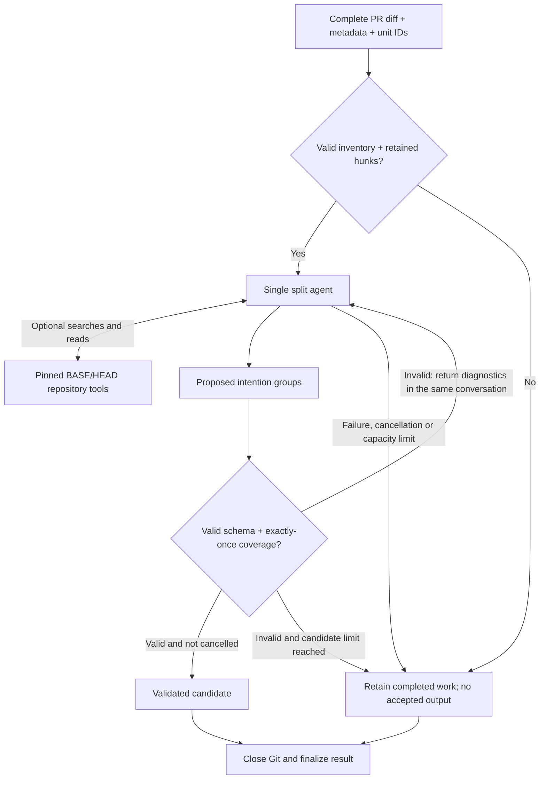

# Semantic split

`@daphne/semantic-split` groups a PR into independently reviewable intentions. It receives the complete supported diff, PR URL/title/body and original unit IDs in one context. Optional `list_changes`, `inspect_change`, `search_code` and `read_source_lines` tools inspect surrounding or unchanged code on the same pinned BASE/HEAD snapshot.

## Flow

The model returns `groups: [{ title, reason, unitIds }]` and `warnings`. Group membership references original units; source code comes from retained Git evidence.

Use intentions' capacities: **256,000 input tokens by default**, **16,384 output tokens**, **8 MiB** per complete context packet/request and **32 MiB** retained evidence. Count the actual request including tools, schema and conversation history. The shared run budget optionally limits candidate count and duration, without default caps. Capacity exhaustion fails explicitly; compression and oversized-PR handling are outside this change.

Only terminal proposals consume candidates; tool turns continue the same conversation. Corrections append diagnostics without dropping the original diff, tool results or provider replay output. Repository tools retain bounded cursor pagination.

## Deterministic validation

1. **Original IDs:** derive `changeId:hunkIndex` from the pinned Git inventory. Require unique change IDs and valid hunk indices; changes without text hunks keep their metadata unit.
2. **Retained entries:** every expected ID maps to exactly one original hunk/metadata entry. Reject missing, extra, duplicate or mismatched entries. A text hunk retains sources for each existing BASE/HEAD side; metadata entries have no source text.
3. **Proposal shape:** require valid JSON with only the declared fields and types, nonblank titles and nonempty unit lists per group. Reasons and warning entries remain strings; they may be empty.
4. **Proposal coverage:** every expected ID appears exactly once across all groups. Reject unknown IDs and duplicates within or across groups. An empty proposal is valid only for an empty inventory.
5. **Code lookup:** resolve IDs through the same captured, immutable mapping and comparison. Preserve original source bytes and order. Retrieved evidence adds context, never new assignable units; model text never supplies source code.

Input/mapping failures stop the run; invalid proposals receive diagnostics for repair in the same conversation. Acceptance also requires successful cleanup and no cancellation. These checks do not assess semantic grouping quality, apply patches or execute builds/tests.

## API and ownership

- `runSemanticSplit(input, options)` captures the comparison before asynchronous work. Options supply provider/model credentials, input limit, optional reasoning effort, one shared `RunBudget`, a borrowed `executeTool` and an optional model-call observer.
- `SemanticSplitResult` retains the comparison, evidence ledger, original hunk mappings, turns, tools, attempts, limits, diagnostics and count/generate/tool counters. Replies live in `SplitTurn`; `SplitAttempt.writerTurnNumber` and `acceptedCandidate` reference them. Failed runs clear proposal, response and acceptance. Empty input succeeds without model calls unless cancelled.
- `getExpectedUnitIds(changes)` and `validateProposal(text, expectedIds)` expose inventory and proposal checks. Prompts, `proposalSchema` and `splitLimits` are exported for inspection and evaluation fingerprints.

`context-engine` owns shared diff/tool retention, evidence notices and complete packet assembly. The pure `review-evidence/tool-definitions` export describes repository tools; the host owns their executor and Git lifetime. `llm.runModelConversation` handles counting, generation and replay. `evaluator-optimizer` controls candidate iteration. Zod owns strict proposal shape; coverage remains deterministic application logic.

The PR host closes Git after investigation; cleanup or late cancellation clears acceptance while retaining completed work. CLI/eval own credentials, error serialization and publication. Split and intentions share the offline tool-packet and delivery readers; proposal checks remain separate. Frozen evaluation verifies captured repositories, commits, inventory and exact source bytes before enabling tools; labels never enter model context.

See [contracts](src/contracts.ts), [proposal validation](src/proposal.ts) and the [implementation plan](../../docs/superpowers/plans/2026-11-04-split-pr-intentions-flow.md).
